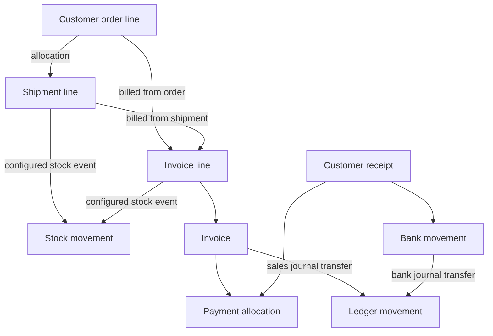

# What a compatible implementation must reproduce

For a given company, configuration, user and starting set of records, apply the same business decision. Compare who could perform it, the accepted quantities and amounts, changed records, downstream effects, and balances visible after a failure or retry. Two systems can use different tables or programming languages and still agree on these results.

## Follow the record that owns the fact

The arrows from order and shipment to invoice show alternative document origins. Stock posting also follows the installation's configured event. Trace the path actually selected in the scenario. [Order and shipment billing](../sales/dispatch-to-invoice.md) · [Stock valuation](../supply/stock.md) · [Journal transfers](../finance/bookkeeping.md)

| Business question | Authoritative evidence | Compatibility check |
| --- | --- | --- |
| What did the customer agree to buy? | Customer order lines, unit, price basis and terms | The agreed quantity and net value remain readable after partial fulfilment. |
| How much has shipped? | Shipment allocation and source order-line ID, qualified by shipment state | Two lines for the same product can produce different outcomes under the built-in closure check and configured workflow. |
| How much was invoiced? | Validated invoice lines and document totals | Reproduce stored line rounding and document-level adjustments in the selected currency/precision. |
| What remains to be paid? | Invoice gross, allocated payments and applied credits/deposits | Split a receipt across two invoices. Preserve each invoice's due amount and the one cash receipt. |
| Has cash cleared the statement? | Bank movement, statement and reconciliation fields | A receipt can reduce the amount due before statement reconciliation. |
| Has the accountant posted it? | Source document or bank-row identity in the journal, bound accounts and period | A commercially validated invoice can still await transfer to the ledger. |

## Names, inputs and service contracts

For a portable operation, declare the business object, caller, entity, settings, input fields and initial state. Declare both the success postcondition and what remains durable on refusal, failure or retry. Use the service route to identify the network contract. For instance the portable [relationship schema](../../schemas/platform/document-link.schema.json) has typed endpoints. The [REST adapter](document-relationships.md) consumes four fields and distinguishes an existing link from a new one.

Carry the internal ID of each record alongside its type. Operators also need the commercial reference assigned by the document's numbering rules. Store line origins where a decision consumes part of an upstream line. Using only product ID loses the distinction between two order lines for the same product. Use a typed document edge for navigation and a dedicated quantitative record for stock moves, allocations and journal entries. [Order conversion](../sales/proposals-and-orders.md) · [Scoped access](execution-and-access.md)

Test commands under a named installation profile. Apply the following decisions in each profile.

- **Status and balance.** An invoice can have zero due and remain open when automatic closure is disabled. [Collections](../finance/collections.md)
- **Reference cost and actual receipt cost.** A supplier offer supplies commercial terms. Weighted stock value changes when a priced movement is posted under the active policy. [Catalogue](../supply/catalogue.md) · [Stock](../supply/stock.md)
- **Grant and record visibility.** A user can have the domain permission and still be denied a record belonging to another party or entity. [Effective access](execution-and-access.md)
- **Business completion and durable side effects.** A failed later operation can leave an earlier transfer movement or an accepted external payment in place. Compare persisted records before replaying the command. [Transfers](../supply/stock.md) · [Point of sale](../commerce/point-of-sale.md)
- **Record shape and cross-record semantics.** A valid receipt shape can still exceed an invoice's outstanding balance. The application enforces that invariant against current records. [Receipt schema](../../schemas/finance/receipt-request.schema.json) · [Settlement scenarios](../finance/collections.md)

An implementation can demonstrate one complete slice by reproducing the [ten-step trading cycle](../trade/worked-cycle.md), then running a second case with a different stock timing, VAT rounding policy or permission. Record the intended differences in the acceptance evidence.
